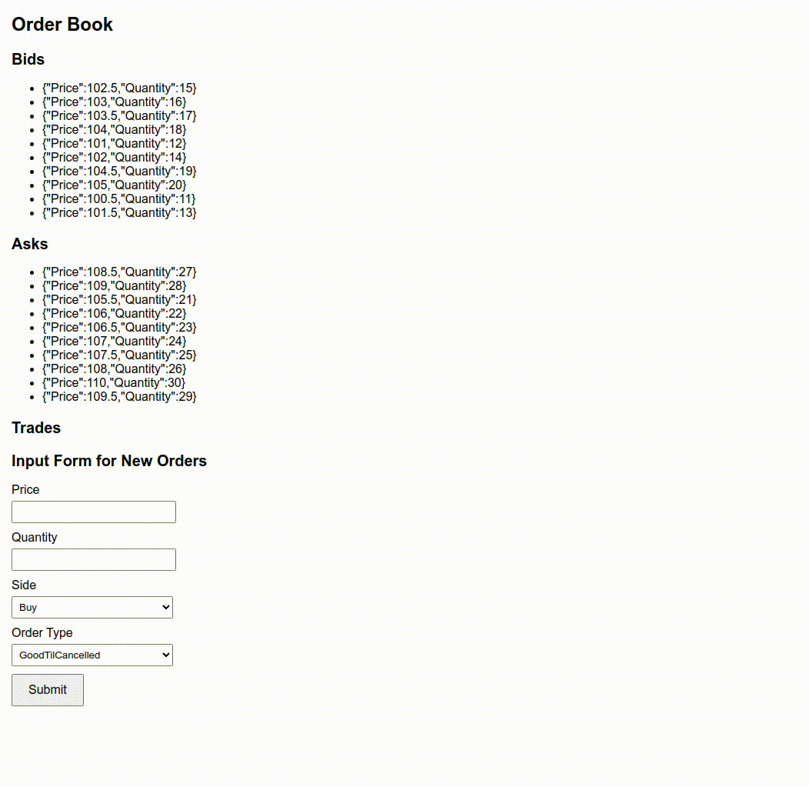

# Limit Orderbook

Basic implementation of an orderbook matching engine for limit orders written in Go

* Support for `Market`, `FillOrKill`, `FillAndKill`, and `GoodTilCancelled` order types
* Sample website simulator for creating and monitoring Bids and Asks
* Standard price time priority



## Prerequisites

* [Go 1.21+](https://go.dev/dl/)

## Running the server

```bash
# Clone the repository
git clone https://github.com/EliasManj/limit-orderbook.git
cd limit-orderbook

# Download dependencies
go mod download

# Start the HTTP server (listens on :8080)
go run main.go
```

> The terminal will block while the server is running — that's normal. Open [http://localhost:8080](http://localhost:8080) in your browser to access the web simulator. Press `Ctrl+C` to stop the server.

## API endpoints

| Method | Path | Description |
|--------|------|-------------|
| `GET` | `/bids/` | List all current bid orders |
| `GET` | `/asks/` | List all current ask orders |
| `POST` | `/order/` | Submit a new order |

**Create order payload:**
```json
{
  "order_type": "GoodTilCancelled",
  "side": "Buy",
  "price": 100.5,
  "qty": 10
}
```

Supported `order_type` values: `Market`, `FillOrKill`, `FillAndKill`, `GoodTilCancelled`  
Supported `side` values: `Buy`, `Sell`

## Order types

| Type | Partial fill? | Rests in book? | Cancelled when |
|------|:---:|:---:|---|
| `GoodTilCancelled` | ✓ | ✓ | Explicitly cancelled |
| `FillOrKill` | ✗ | ✗ | Full quantity not available immediately |
| `FillAndKill` | ✓ | ✗ | After matching, any unfilled remainder is dropped |
| `Market` | ✓ | ✓ (converted to GTC at worst available price) | No opposing orders available |

## Seeding orders

A helper script creates a batch of random orders against the running server:

```bash
# Create 20 orders (default)
./test/create_orders.sh

# Create a custom number of orders
./test/create_orders.sh -n 50
```

## Running tests

```bash
go test ./...
```

